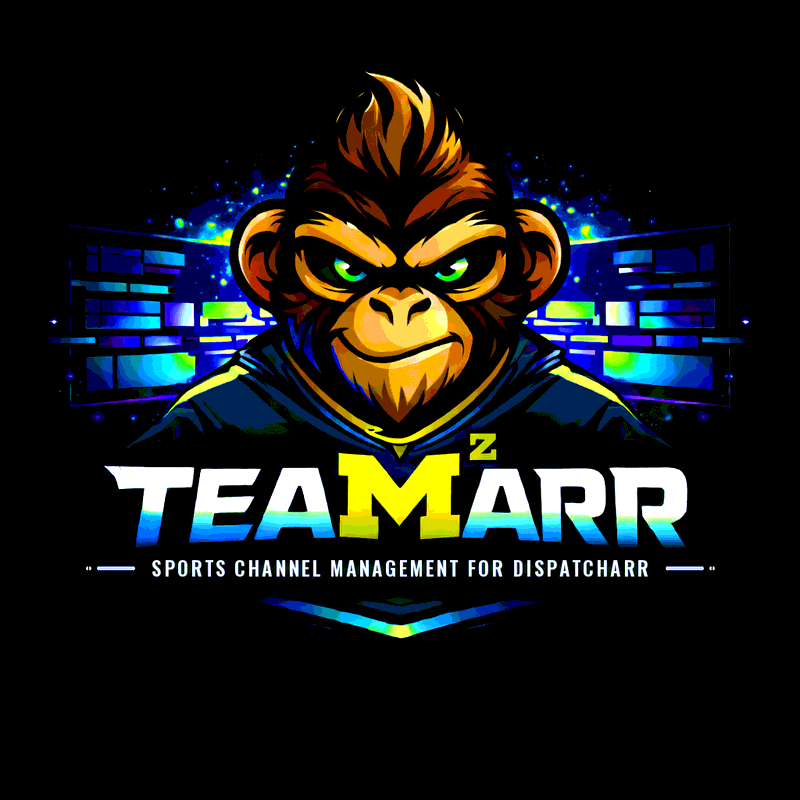

<p align="center">
  
</p>

<p align="center"><strong>Sports Channel Management for <a href="https://github.com/Dispatcharr/Dispatcharr">Dispatcharr</a></strong></p>

## Quick Start

```yaml
services:
  teamarr:
    image: ghcr.io/pharaoh-labs/teamarr:latest
    container_name: teamarr
    restart: unless-stopped
    ports:
      - 9195:9195
    volumes:
      - ./data:/app/data
    environment:
      - TZ=America/Detroit
```

```bash
docker compose up -d
```

## Image Tags

| Tag | Description |
|-----|-------------|
| `latest` | Stable release |
| `dev` | Development builds |

## Documentation

Cricket: IPL, BBL, SA20 and Major League Cricket use ESPN without a premium key,
with team import and team channels alongside international Test, ODI and T20I event coverage.

**Official Docs**: [pharaoh-labs.github.io/teamarr](https://pharaoh-labs.github.io/teamarr/) — User Guide, Technical Reference, Supported Leagues

## Contributing

Bug reports, league requests, and pull requests are welcome. See the [Contributing Guide](CONTRIBUTING.md). PRs target `dev`.

## License

Teamarr is free software licensed under the [GNU Affero General Public License v3.0 only](LICENSE) (AGPL-3.0-only).

Copyright (C) 2025-2026 Pharaoh Labs and Teamarr contributors.

If you run a modified Teamarr for other people over a network, the AGPL requires you to offer them the corresponding source.

Releases before v2.18.0 were offered under the MIT License as declared in this README, and those historical permissions remain unaffected.

## Attribution

Teamarr reads publicly available sports data and artwork from ESPN and other providers. All team names, logos, and trademarks are property of their respective owners.
