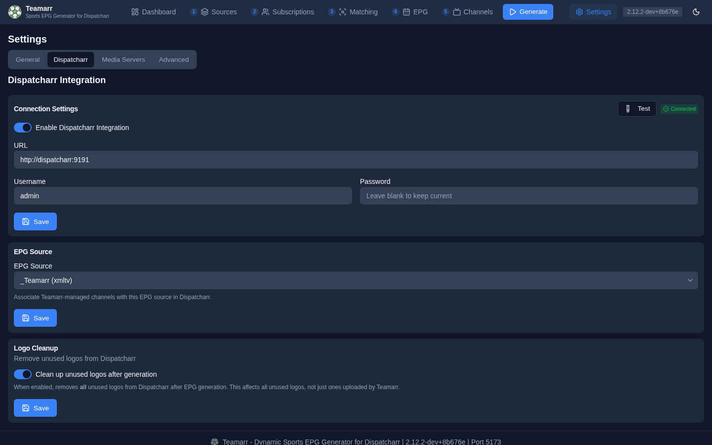

# Dispatcharr Integration

Configure the connection to Dispatcharr for automatic channel management. The tab holds four cards — **Connection Settings**, **EPG Source**, **M3U Refresh**, and **Logo Cleanup** — each with its own Save button.

{: .note }
Default channel **profiles**, the **stream profile**, and the **channel group / group mode** moved to [Channels → Dispatcharr Output](../channels/output) in the v2.7.0 IA overhaul — they're channel-routing concerns, not connection settings.

## Connection Settings

Server URL and credentials for connecting to Dispatcharr.

| Field | Description |
|-------|-------------|
| **Enable** | Toggle Dispatcharr integration on/off |
| **URL** | Dispatcharr server URL (e.g., `http://localhost:9191`) |
| **API Key** | Recommended. A personal API key from your Dispatcharr profile page (Dispatcharr 0.20.0 or later). When a key is saved, Teamarr sends it on every request and never uses the username and password. The saved key is never displayed — the field loads empty with "Leave blank to keep current"; **Remove saved key** drops it and goes back to the username and password |
| **Username** | Dispatcharr login username. Used only when no API key is saved |
| **Password** | Dispatcharr login password. Used only when no API key is saved. The saved password is never displayed — the field loads empty with "Leave blank to keep current" |

Use the **Test** button to verify your connection — a successful test reports the connected account's live counts (accounts, groups, channels) and says when it connected via the API key. A key typed into the field is tested as typed; a typed password is tested even when a key is saved.

**Use an API key instead** appears under the field while a username and password are saved and no key is. It switches the connection in one click: Teamarr logs in with the saved password, adopts the key already on your Dispatcharr account, or generates one only when the account has none, and saves it. Your password stays saved until you clear it.

**Why a key?** Dispatcharr keeps one API key per user, which you can revoke at any time from your profile without changing your password, and Teamarr then holds nothing that can log into Dispatcharr's web UI. Generating a new key on the profile page replaces the old one, so paste the new key here afterwards.

### Connection Status

A status badge shows the current connection state:

| Status | Description |
|--------|-------------|
| **Connected** | Successfully communicating with Dispatcharr |
| **Disconnected** | Configured but unable to connect |
| **Error** | Connection failed — hover for details; a red **Connection Failed** banner with the error also appears above the fields |
| **Not Configured** | Integration not yet set up |

## EPG Source

Select which EPG source in Dispatcharr to associate with Teamarr-managed channels. This links your channels to the correct guide data. The dropdown is disabled until the connection is live, and lists each source as `name (type)`.

If you haven't created an EPG source in Dispatcharr yet, do that first — see the [Dispatcharr Integration Guide](../dispatcharr-integration) for the full walkthrough.

## M3U Refresh

**Refresh M3U accounts before generation** (on by default). When on, each EPG generation and each group preview asks Dispatcharr to refresh the group's M3U account first, unless it was refreshed recently (30 minutes for generation, 60 for a preview).

Turn it off if you refresh your M3U accounts on your own schedule, or your provider limits how often it can be hit. Teamarr then reads the streams Dispatcharr already has; the generation log shows one `[M3U] Refresh skipped` line per run.

## Logo Cleanup

When enabled, removes **all** unused logos from Dispatcharr after EPG generation.

{: .warning }
This affects all unused logos in Dispatcharr, not just ones uploaded by Teamarr. Use with caution if you have manually uploaded logos that are not actively assigned to channels.
